# Quiz Clicker: thiết bị IoT trả lời trắc nghiệm trên lớp (STEM Quiz)

<p align="center">
  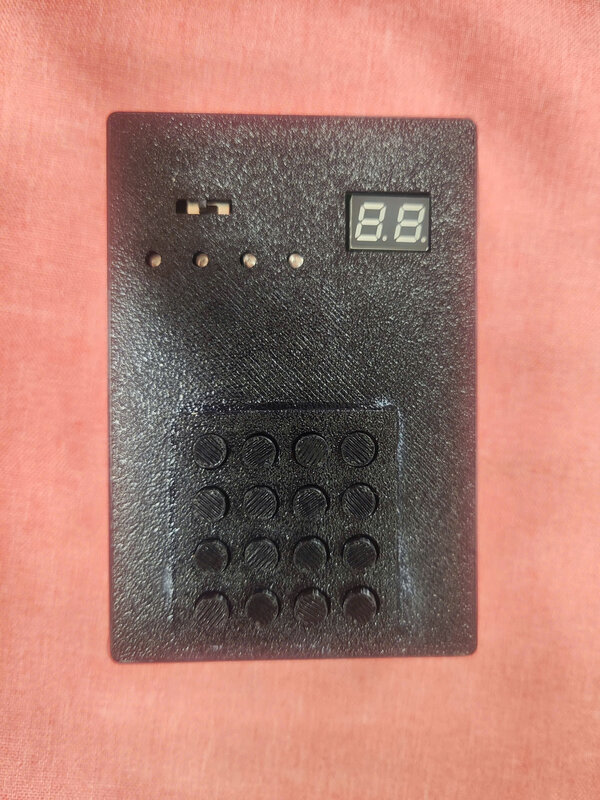
</p>

Báo cáo dự án **STEM Quiz**: hệ thống trắc nghiệm trực tiếp kiểu Kahoot chạy hoàn toàn trong mạng nội bộ của lớp học. Học sinh trả lời bằng **thiết bị bấm IoT ESP32 ** hoặc điện thoại; giáo viên điều khiển và xem kết quả trên web.

## Thành viên nhóm

| STT | Họ và tên | MSSV |
|:---:|---|:---:|
| 1 | Bui Dinh Khoi | 23134032 |
| 2 | Le Thanh Sang | 23134049 |
| 3 | Bui Huynh Phuong Anh | 23134002 |
| 4 | Pham Trung Kien | 23134034 |

> Mọi sơ đồ viết bằng [Mermaid](https://mermaid.js.org/), GitHub tự vẽ ngay trên trang. Ảnh PNG nằm trong [`docs/images/`](docs/images).

## Mục lục

1. [Giới thiệu](#1-giới-thiệu)
2. [Kiến trúc hệ thống](#2-kiến-trúc-hệ-thống)
3. [Cấu trúc dữ liệu](#3-cấu-trúc-dữ-liệu)
4. [Luồng thực thi](#4-luồng-thực-thi)
5. [Bảo mật và toàn vẹn dữ liệu](#5-bảo-mật-và-toàn-vẹn-dữ-liệu)
6. [Kiểm thử](#6-kiểm-thử)
7. [Cài đặt và vận hành](#7-cài-đặt-và-vận-hành)
8. [Hạn chế và hướng phát triển](#8-hạn-chế-và-hướng-phát-triển)
9. [Danh mục mã nguồn](#9-danh-mục-mã-nguồn)

---

## 1. Giới thiệu

### 1.1. Bài toán
Giáo viên cần kiểm tra nhanh mức hiểu bài của cả lớp. Giơ tay hay gọi tên thì chậm, không lưu lại được, và học sinh ngại sai trước lớp. Kahoot hay Quizizz lại cần mỗi em một điện thoại có Internet, điều mà nhiều trường không cho phép hoặc không đủ điều kiện.

### 1.2. Giải pháp
- **Giáo viên** dùng web trên laptop: quản lý lớp, học sinh, ngân hàng câu hỏi (soạn tay, nhập CSV hoặc tạo bằng AI), chạy quiz trên máy chiếu, xem kết quả và tiến bộ.
- **Học sinh** bấm trả lời trên **thiết bị ESP32** (bàn phím 4×4, 2 LED 7 đoạn, 4 LED A–D) hoặc trên **điện thoại** (trang `phone.php`).
- Thiết bị nói chuyện với máy chủ qua **Wi-Fi (HTTP + JSON)**; **Bluetooth Low Energy** là đường dự phòng, đi qua một chương trình cầu nối trên laptop.
- **Không cần Internet trong giờ học**: laptop giáo viên vừa phát Wi-Fi, vừa là máy chủ web và database, vừa là trạm Bluetooth.

### 1.3. Tính năng chính

| Nhóm | Tính năng |
|---|---|
| Lớp và học sinh | Tạo lớp; nhập danh sách từ CSV hoặc dán từ Excel (STT · MSSV · Họ tên) có bước xem trước |
| Câu hỏi | Quiz 2–4 lựa chọn, sắp xếp lại thứ tự, nhập CSV, **tạo bằng AI** từ tài liệu bài học (Claude hoặc Gemma chạy trên máy) |
| Chạy quiz | Mã phòng 2 chữ số, phòng chờ thời gian thực, đếm số em đã trả lời, Next / End |
| Thiết bị | Mã thiết bị 2 số, khoá/mở, mã QR cho điện thoại |
| Phân tích | Ma trận học sinh × câu tô màu theo độ khó, phân bố đáp án, biểu đồ tiến bộ, cảnh báo học sinh cần chú ý |
| Ôn tập | Tự tạo quiz mới từ những câu cả lớp hay sai nhất |
| Đường truyền | Wi-Fi tự tìm máy chủ (mDNS); Bluetooth cho ESP32 và điện thoại Android (Web Bluetooth) |

### 1.4. Giao diện web

| Trang chủ (Dashboard) | Ngân hàng quiz |
|:---:|:---:|
| 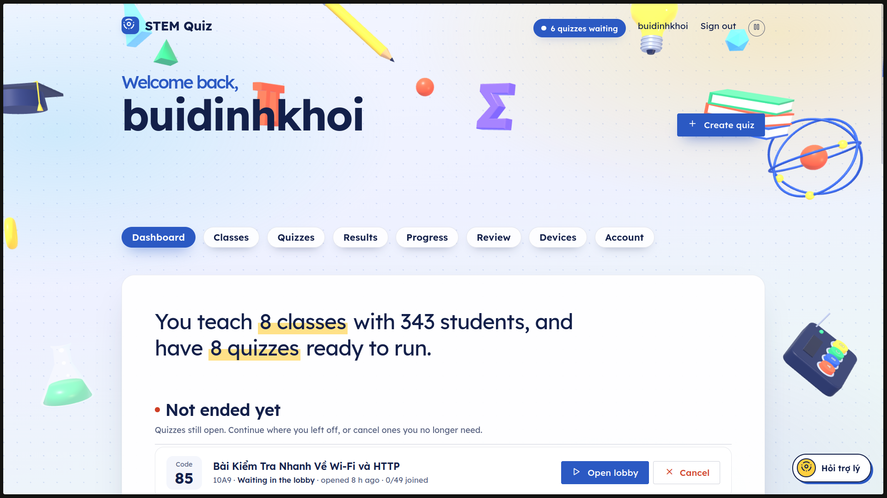 | 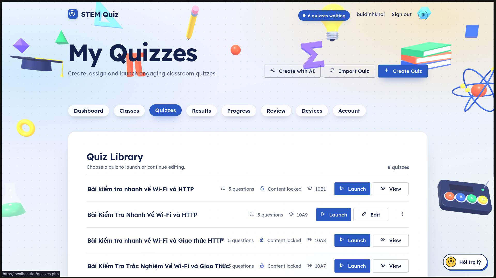 |
| **Danh sách lớp** | **Kết quả các buổi quiz** |
| 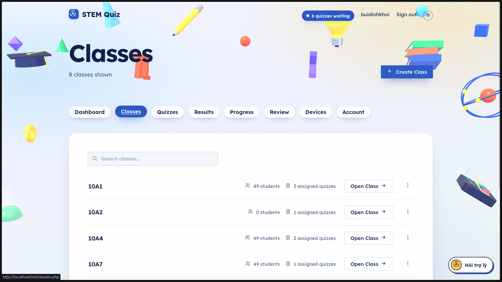 | 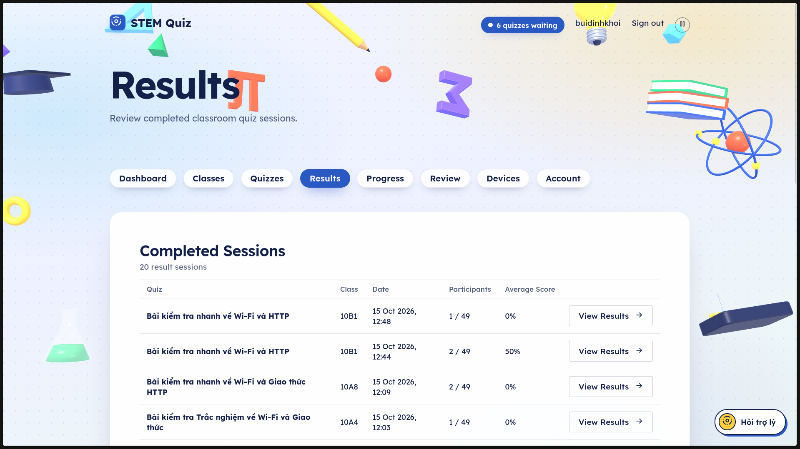 |
| **Tiến bộ của lớp** | |
| 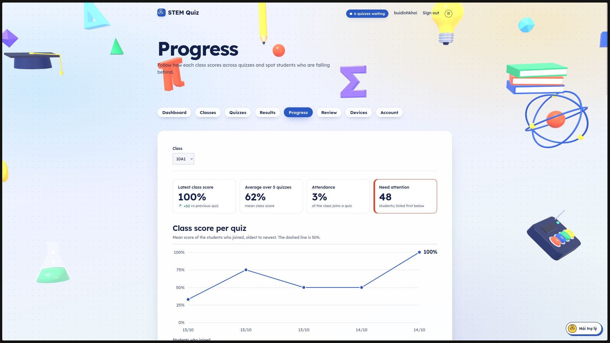 | |

---

## 2. Kiến trúc hệ thống

### 2.1. Tổng quan

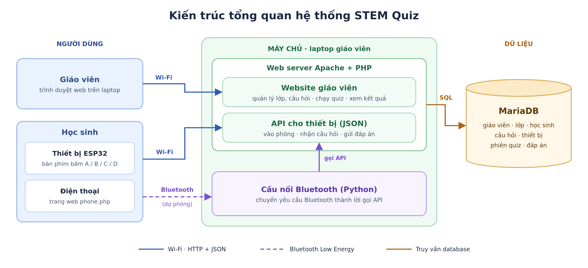

Một nguyên tắc xuyên suốt: **database là nguồn sự thật duy nhất** và **mọi thiết bị đều gọi cùng 3 API** (`join`, `session_state`, `answer`). Đi Wi-Fi hay Bluetooth thì logic nghiệp vụ vẫn chỉ nằm ở một chỗ là PHP.

### 2.2. Các thành phần

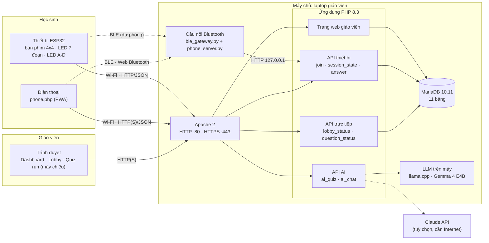

| Thành phần | Vai trò |
|---|---|
| **Thiết bị ESP32** | Nhập STT, mã phòng, chọn A–D; hỏi trạng thái phiên mỗi giây; tự tìm máy chủ; lưu phiên vào flash |
| **Điện thoại** | Trang `phone.php` dùng đúng 3 API như ESP32; cài được như ứng dụng (PWA), mở được khi mất mạng |
| **Web giáo viên** | Quản lý lớp, quiz, thiết bị; chạy quiz; kết quả, tiến bộ, ôn tập |
| **API JSON** | Cửa vào duy nhất của thiết bị; kiểm tra chặt đầu vào; transaction và khoá hàng |
| **Cầu nối Bluetooth** | Chỉ chuyển đổi giao thức BLE ↔ HTTP, không chứa logic nghiệp vụ |
| **MariaDB** | Lưu toàn bộ dữ liệu, ràng buộc khoá ngoại và duy nhất |
| **AI** | Soạn câu hỏi trắc nghiệm từ tài liệu; mặc định chạy Gemma trên GPU laptop (miễn phí, offline) |

### 2.3. Triển khai mạng

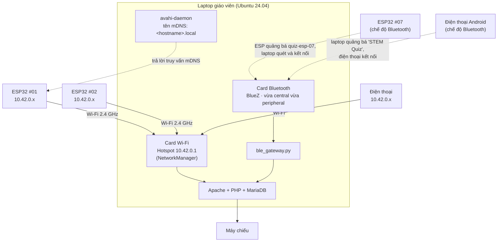

Hai chiều Bluetooth **ngược vai** nhau:
- Với ESP32, laptop là **central** (đi tìm và kết nối), ESP32 là **peripheral**.
- Với điện thoại, laptop là **peripheral** (phát quảng bá), vì trình duyệt chỉ làm được central.

### 2.4. Phân tầng phần mềm phía máy chủ

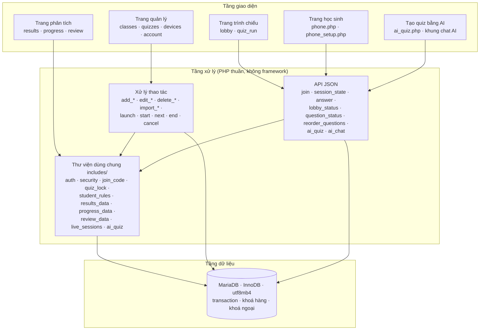

### 2.5. Phần cứng thiết bị ESP32

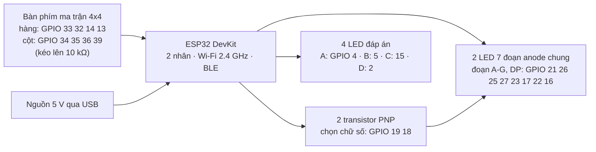

Bố trí phím:

| | | | |
|---|---|---|---|
| `1` | `2` | `3` | `A` |
| `4` | `5` | `6` | `B` |
| `7` | `8` | `9` | `C` |
| `*` | `0` | `#` | `D` |

`0–9` nhập số, `A–D` chọn đáp án, `#` xác nhận/gửi, `*` xoá hoặc quay lại; **bấm `*` hai lần trong 0,5 giây** để đổi Wi-Fi ↔ Bluetooth.

### 2.6. Kiến trúc firmware

Firmware chạy hai luồng FreeRTOS song song để màn hình không bao giờ nháy và không mất phím, kể cả khi đang chờ mạng.

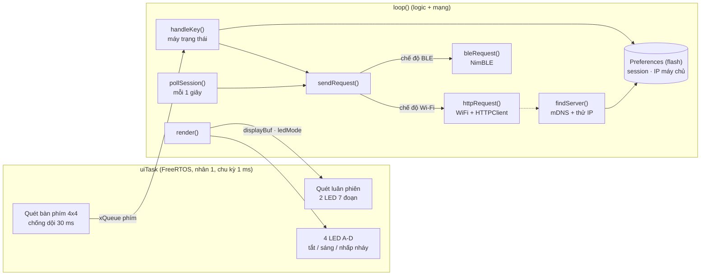

Mọi lời gọi API đi qua một hàm `sendRequest()`, hàm này tự chọn HTTP hay BLE, nên phần vào phòng, hỏi trạng thái và gửi đáp án không phân biệt đường truyền.

### 2.7. Công nghệ sử dụng

| Thành phần | Công nghệ |
|---|---|
| Hệ điều hành máy chủ | Ubuntu 24.04 |
| Web server | Apache 2.4, HTTPS bằng CA nội bộ |
| Backend | PHP 8.3 thuần, `mysqli` + prepared statement |
| Database | MariaDB 10.11, InnoDB, utf8mb4 |
| Frontend | HTML/CSS/JS thuần, three.js 0.149 (nền 3D), SweetAlert2, Tabler Icons |
| Thiết bị | ESP32 (Arduino core 3.x), FreeRTOS, `WiFi`, `HTTPClient`, `ESPmDNS`, `Preferences`, NimBLE-Arduino 2.x |
| Cầu nối Bluetooth | Python 3.12, `bleak` (central), `dbus-fast` (GATT server qua BlueZ) |
| Điện thoại | Web Bluetooth API, Service Worker, Web App Manifest (PWA) |
| AI | llama.cpp + Gemma 4 E4B trên máy; hoặc Claude API qua `anthropic-ai/sdk` |
| Mạng | NetworkManager hotspot, avahi (mDNS), BlueZ; Cloudflare Tunnel (tuỳ chọn) |

---

## 3. Cấu trúc dữ liệu

### 3.1. Sơ đồ quan hệ thực thể (ERD)

Sơ đồ được vẽ từ chính schema đang chạy (11 bảng). Ảnh PNG: [`docs/images/erd.png`](docs/images/erd.png).

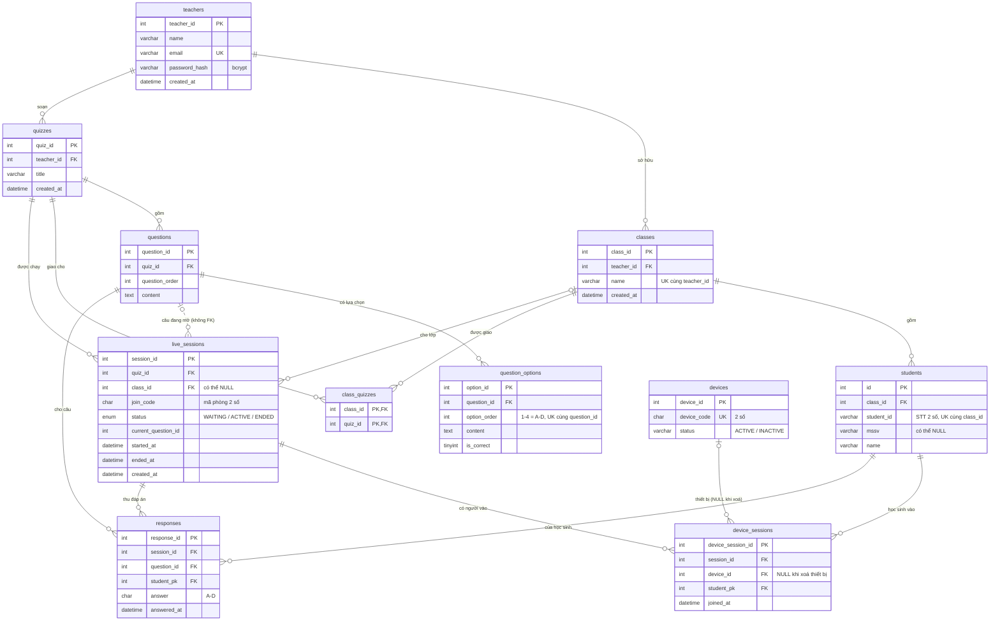

### 3.2. Nhóm bảng

| Nhóm | Bảng | Ý nghĩa |
|---|---|---|
| Người dùng | `teachers` | Tài khoản giáo viên; mọi dữ liệu khác tách theo giáo viên |
| Lớp học | `classes`, `students` | Lớp và học sinh. `student_id` là **STT 2 chữ số** nhập trên thiết bị, `mssv` là mã số của trường |
| Ngân hàng câu hỏi | `quizzes`, `questions`, `question_options`, `class_quizzes` | Bộ câu hỏi, câu hỏi, lựa chọn A–D, quiz giao cho lớp nào |
| Thiết bị | `devices` | Mã 2 số của ESP32 hoặc điện thoại, dùng chung cho mọi giáo viên |
| Phiên trực tiếp | `live_sessions`, `device_sessions`, `responses` | Mỗi lần chạy quiz; ai vào bằng thiết bị nào; ai trả lời gì |

### 3.3. Ràng buộc quan trọng

| Ràng buộc | Bảng | Tác dụng |
|---|---|---|
| `UNIQUE (session_id, question_id, student_pk)` | `responses` | Mỗi học sinh trả lời **1 lần mỗi câu**, kể cả khi hai yêu cầu đến cùng lúc |
| `UNIQUE (session_id, device_id)` | `device_sessions` | Một thiết bị chỉ vào một phòng một lần |
| `UNIQUE (session_id, student_pk)` | `device_sessions` | Một học sinh chỉ vào phòng bằng một thiết bị |
| `UNIQUE (class_id, student_id)` | `students` | STT không trùng trong lớp |
| `UNIQUE (teacher_id, name)` | `classes` | Một giáo viên không có hai lớp trùng tên |
| `UNIQUE (question_id, option_order)` | `question_options` | Mỗi câu chỉ có một A, một B… |
| `UNIQUE device_code`, `UNIQUE email` | `devices`, `teachers` | Mã thiết bị và email không trùng |
| `INDEX (join_code, status)` | `live_sessions` | Tìm nhanh phòng đang mở theo mã phòng |
| Khoá ngoại `RESTRICT` | mọi bảng | Không xoá được dữ liệu đang được tham chiếu |
| `ON DELETE SET NULL` | `device_sessions.device_id` | Xoá mã thiết bị vẫn **giữ kết quả cũ** |

`current_question_id` không có khoá ngoại; tính hợp lệ của nó do PHP bảo đảm (chỉ gán câu thuộc đúng quiz của phiên).

### 3.4. Cách tính điểm
- **Câu đã được hỏi** trong một phiên: các câu có `question_order` ≤ thứ tự của câu cuối cùng được mở.
- **Điểm** = số câu đúng (đáp án trùng `question_options.is_correct = 1`) / số câu đã được hỏi.
- Chỉ tính phiên `ENDED` có ít nhất một học sinh tham gia. Trang Kết quả, Tiến bộ và Ôn tập dùng chung cách tính này.

### 3.5. Dữ liệu được lưu ở đâu

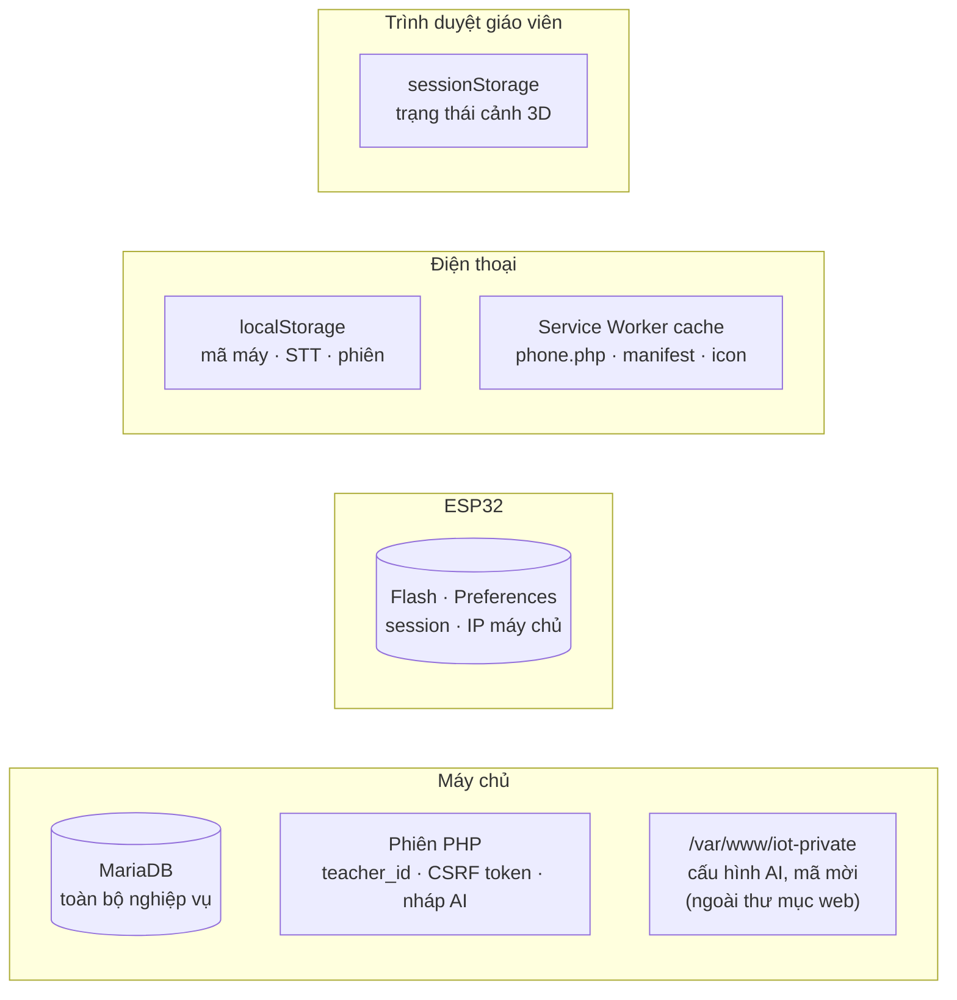

| Nơi lưu | Dữ liệu | Thời hạn |
|---|---|---|
| MariaDB | Toàn bộ dữ liệu nghiệp vụ (11 bảng) | Lâu dài, nguồn sự thật duy nhất |
| Phiên PHP | `teacher_id`, CSRF token, nháp quiz AI | Đến khi đăng xuất |
| Flash ESP32 | `session` đang làm, IP máy chủ tìm được | Qua mất điện, khởi động lại |
| `localStorage` điện thoại | Mã máy, STT, phiên đang làm | Qua tải lại trang |
| Service Worker cache | Bản sao `phone.php` | Để mở được khi mất Wi-Fi |

### 3.6. Định dạng dữ liệu trao đổi

**API cho thiết bị (JSON):**

| API | Phương thức | Vào | Ra |
|---|---|---|---|
| `api/join.php` | POST | `device_id`, `student_id`, `join_code` | `{"status":"OK","session_id":15}` (thêm `"rejoined":true` khi vào lại) |
| `api/session_state.php` | GET | `device_id`, `session_id` | `WAITING` / `ACTIVE` + `question_id`, `question_order` / `ENDED` |
| `api/answer.php` | POST | `device_id`, `session_id`, `question_id`, `answer` (A–D) | `{"status":"OK"}` |

Lỗi luôn có dạng `{"status":"ERROR","reason":"..."}`. Firmware đổi `reason` thành mã lỗi trên LED:

| Mã LED | `reason` từ máy chủ | Nghĩa |
|---|---|---|
| E1 | (không có trả lời), `server_error` | Không tới được máy chủ, giữ nguyên số đã nhập / đáp án đã chọn để thử lại |
| E2 | `device_not_registered`, `device_inactive` | Thiết bị chưa đăng ký hoặc bị khoá |
| E3 | `invalid_join_code` | Sai mã phòng |
| E4 | `session_not_waiting` | Phòng đã bắt đầu |
| E5 | `student_not_in_class` | STT không có trong lớp |
| E6 | `device_already_joined`, `student_already_joined` | Thiết bị hoặc học sinh đã vào phòng |
| E7 | `already_answered` | Câu này đã trả lời |
| E8 | `device_not_joined`, `session_not_found` | Không còn trong phòng (phòng bị huỷ), tự về màn hình nhập |
| E9 | còn lại (`invalid_option`, `invalid_request`…) | Lỗi khác |

Riêng `stale_question` và `session_not_active` khi gửi đáp án thì thiết bị không báo lỗi mà hỏi lại trạng thái ngay để hiện câu mới.

**Gói Bluetooth ESP32 ↔ cầu nối** (MTU 247, một yêu cầu đi trọn một gói):

```
Yêu cầu  (ESP ghi vào REQUEST, rồi notify):  "<seq>\n<path>\n<JSON body>"
          ví dụ: "7\nanswer.php\n{\"device_id\":\"01\",\"session_id\":19,\"question_id\":123,\"answer\":\"B\"}"
Trả lời  (cầu nối ghi vào RESPONSE):          "<seq>\n1\n<JSON từ API>"   hoặc   "<seq>\n0\n" (không tới được máy chủ)
```

| UUID | Vai trò | Thuộc tính |
|---|---|---|
| `5ca7d9a4-0492-45e2-aaff-dbb32658be6b` | Service quiz | |
| `e6dd137a-6c6c-4142-884e-51e4a17a9211` | REQUEST: ESP → laptop | READ, NOTIFY |
| `3551aab3-72c0-4dec-9f9a-259bffe6ccbe` | RESPONSE: laptop → ESP | WRITE |

Số thứ tự `seq` giúp ESP bỏ qua trả lời cũ và giúp cầu nối không xử lý một yêu cầu hai lần.

**Lệnh ngắn điện thoại ↔ cầu nối** (vừa gói BLE nhỏ nhất 20 byte):

| Lệnh | API tương ứng |
|---|---|
| `J,<máy>,<STT>,<mã phòng>` — ví dụ `J,03,09,49` | `join.php` |
| `S,<máy>,<session_id>` — ví dụ `S,03,19` | `session_state.php` |
| `A,<máy>,<session_id>,<question_id>,<A-D>` — ví dụ `A,03,19,123,B` | `answer.php` |

### 3.7. Cấu trúc dữ liệu trong firmware

| Biến | Kiểu | Ý nghĩa |
|---|---|---|
| `mode` | `enum Mode` | `RESUME`, `INPUT_STUDENT`, `INPUT_CODE`, `WAITING`, `ACTIVE`, `ENDED` |
| `studentId[3]`, `joinCode[3]` | `char[]` | STT và mã phòng 2 chữ số vừa nhập |
| `sessionId`, `questionId`, `questionOrder` | `long` | Phiên đang tham gia và câu đang mở |
| `chosen`, `answered` | `char`, `bool` | Đáp án đã chọn, đã gửi thành công chưa |
| `displayBuf[2]`, `displayBlink` | `volatile byte[]`, `bool` | Hình 2 chữ số cho `uiTask` quét |
| `ledMode[4]` | `volatile LedMode[]` | Trạng thái 4 LED A–D: tắt / sáng / nhấp nháy |
| `keyQueue` | `QueueHandle_t` | Hàng đợi phím từ `uiTask` sang `loop()` |
| `serverBase` | `String` | `http://<ip>/iot/api/` đang dùng; rỗng = chưa tìm thấy |
| `bleMode`, `bleGatewayReady` | `bool` | Đang dùng Bluetooth; laptop đã đăng ký nghe |
| `bleReply`, `bleReplySeq` | `String`, `uint32_t` | Trả lời mới nhất từ laptop (khoá bằng semaphore) |

---

## 4. Luồng thực thi

### 4.1. Một buổi quiz từ đầu đến cuối

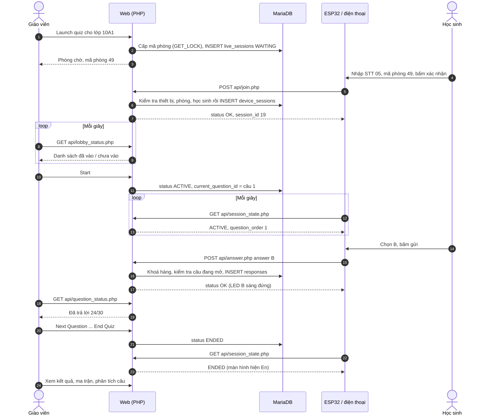

### 4.2. Trạng thái phiên quiz (`live_sessions.status`)

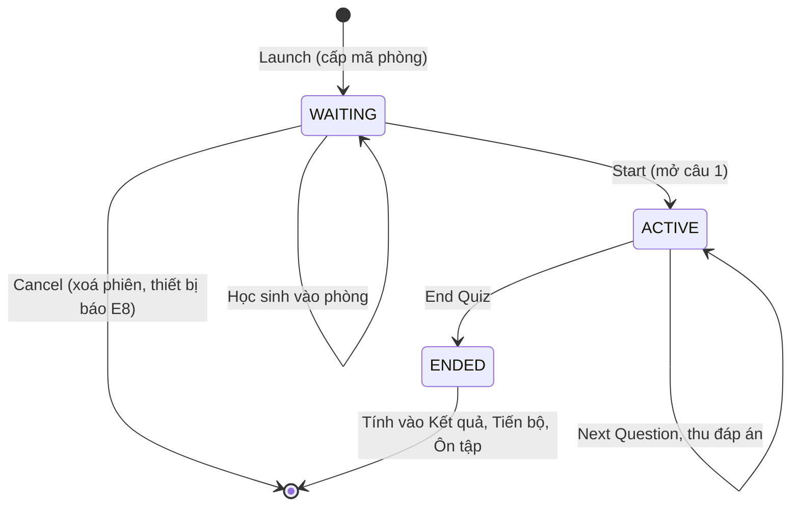

- `WAITING`: cho vào phòng. `ACTIVE`: đang hỏi, không nhận người mới (trừ thiết bị **vào lại**). `ENDED`: đã khoá, chỉ để xem kết quả.
- Quiz đã từng chạy bị **khoá chỉnh sửa** (`includes/quiz_lock.php`) để kết quả cũ không bị sai lệch.

### 4.3. Mở phòng (Launch)

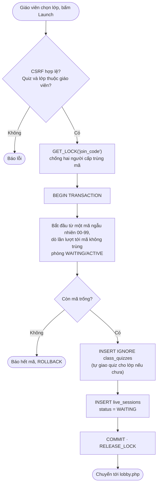

### 4.4. Xử lý `api/join.php`

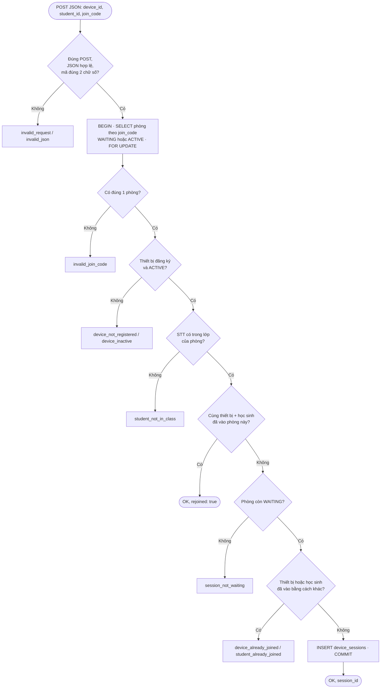

Nhờ nhánh **vào lại**, ESP32 mất điện hay điện thoại tải lại trang vẫn quay về đúng phòng kể cả khi quiz đã bắt đầu.

### 4.5. Xử lý `api/answer.php`

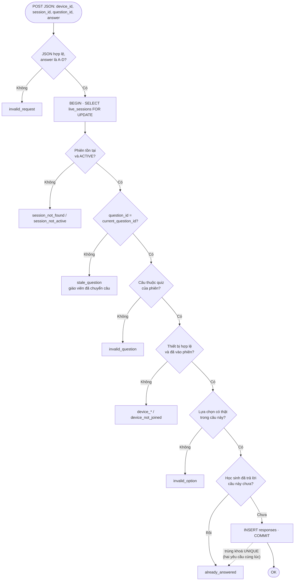

Khoá hàng `FOR UPDATE` làm cho thao tác Next/End của giáo viên và việc ghi đáp án không chen vào nhau; ràng buộc `UNIQUE` là lớp chặn cuối cùng.

### 4.6. Máy trạng thái thiết bị ESP32

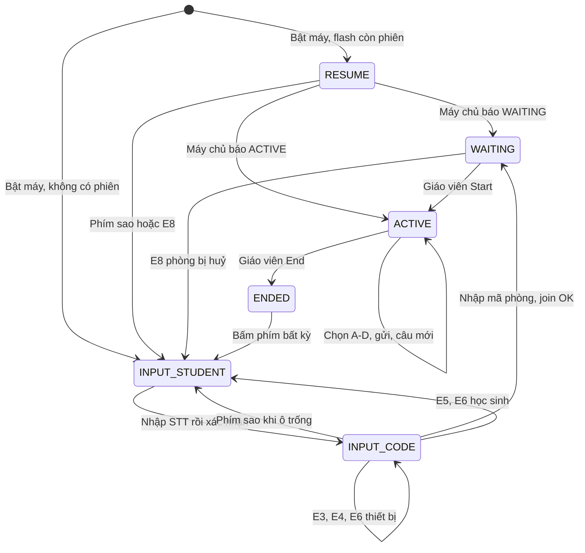

Màn hình LED tương ứng:

| Màn hình | Ý nghĩa |
|---|---|
| `--` nhấp nháy | Đang kết nối Wi-Fi hoặc tìm máy chủ |
| `--.` nhấp nháy | Đang ở Bluetooth, chờ laptop kết nối |
| `HS` | Nhập số thứ tự học sinh |
| `JC` | Nhập mã phòng |
| `--` đứng yên | Đã vào phòng, chờ Start |
| `01`, `02`… | Câu đang mở. LED đáp án nhấp nháy = đã chọn chưa gửi, sáng đứng = đã gửi |
| `En` | Quiz kết thúc |
| Chấm bên phải | Đang dùng Bluetooth |

### 4.7. Vòng lặp chính của firmware

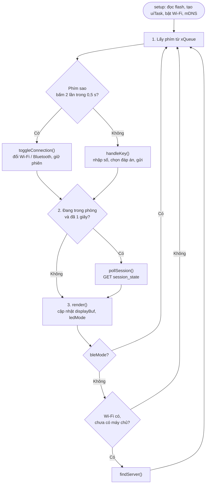

### 4.8. ESP32 tự tìm máy chủ

ESP32 không cần biết IP của laptop. Mỗi ứng viên được **gọi thử `session_state.php`** để chắc đúng là máy chủ quiz.

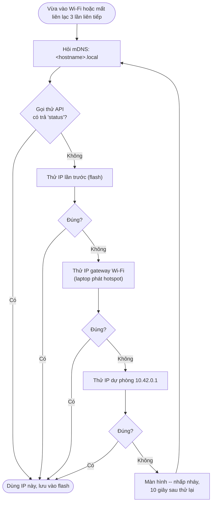

### 4.9. ESP32 trả lời qua Bluetooth

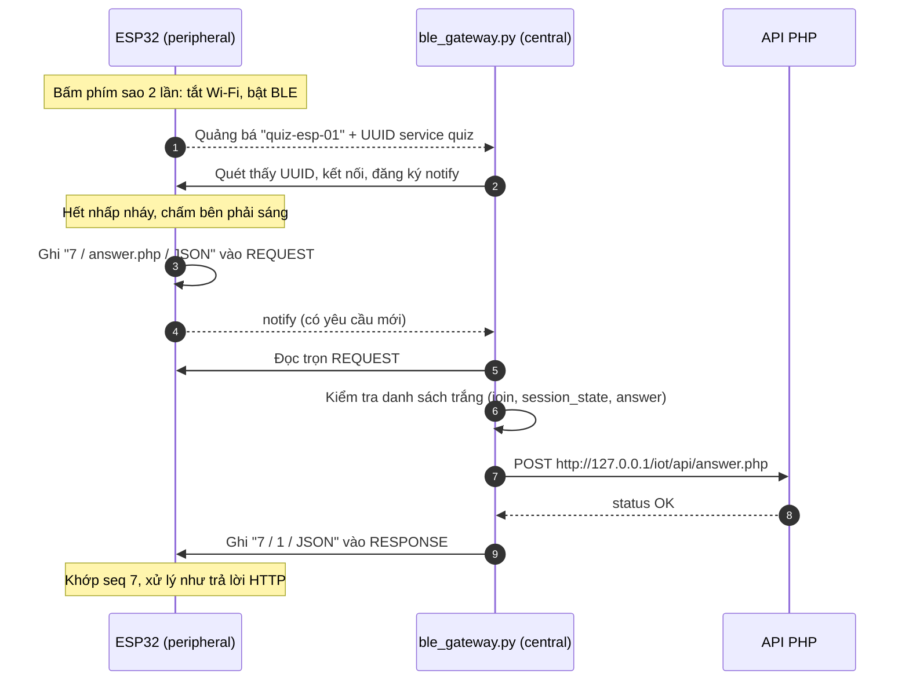

Cầu nối kết nối lần lượt từng ESP32 (BlueZ chỉ kết nối một thiết bị mỗi lúc), tự quét lại khi ESP mất kết nối.

### 4.10. Điện thoại Android trả lời qua Bluetooth

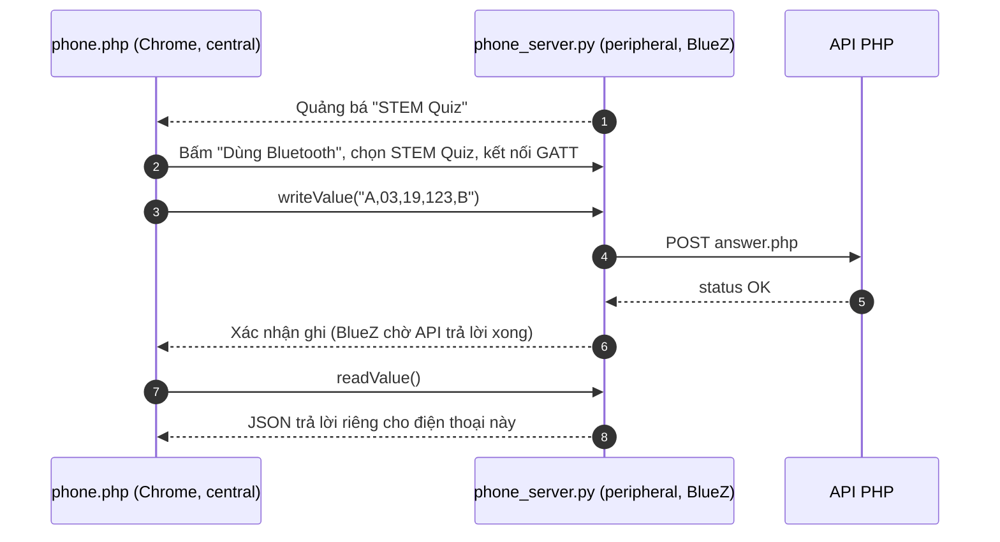

Mất kết nối thì trang tự nối lại 3 lần; Bluetooth không dùng được thì trang gửi qua Wi-Fi như bình thường.

### 4.11. Tạo quiz bằng AI

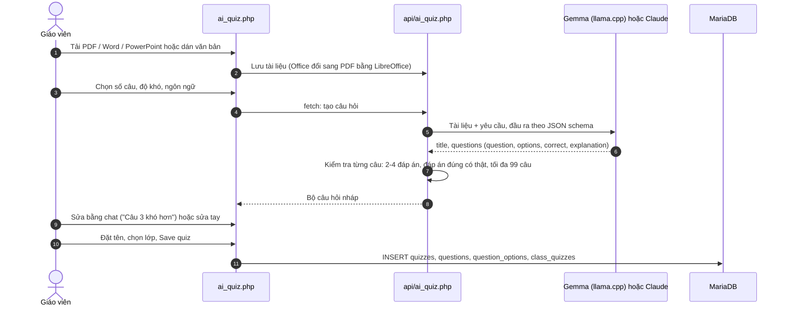

AI không bao giờ lưu thẳng vào database: giáo viên luôn phải xem lại trước khi lưu.

---

## 5. Bảo mật và toàn vẹn dữ liệu

| Biện pháp | Áp dụng |
|---|---|
| Prepared statement | Mọi truy vấn SQL, chống SQL injection |
| `htmlspecialchars` | Mọi dữ liệu xuất ra HTML, chống XSS |
| CSRF token | Biểu mẫu thay đổi dữ liệu, API sắp xếp câu hỏi |
| bcrypt | Mật khẩu giáo viên (`password_hash` / `password_verify`) |
| Kiểm tra quyền sở hữu | Lớp, quiz, phiên đều lọc theo `teacher_id` đăng nhập |
| Transaction + `SELECT … FOR UPDATE` | Vào phòng, trả lời, bắt đầu, huỷ phiên, xoá hàng loạt |
| `GET_LOCK` | Cấp mã phòng không trùng khi nhiều người bấm cùng lúc |
| Mã mời đăng ký, chống dò mật khẩu | Đăng ký cần mã mời; sai nhiều lần thì khoá tạm thời |
| Cookie phiên | `HttpOnly`, `SameSite=Lax`, `Secure` khi HTTPS, đổi mã phiên sau đăng nhập |
| Chặn Internet cho API thiết bị | Yêu cầu qua Cloudflare Tunnel (có `Cf-Connecting-Ip`) bị 403 ở `join`, `answer`, `session_state` |
| Danh sách trắng ở cầu nối | Bluetooth chỉ gọi được 3 API thiết bị |
| CA nội bộ có Name Constraints | Chỉ ký được cho IP nội bộ và `*.local`, lộ khoá CA cũng không giả mạo được trang ngoài |
| Bí mật ngoài thư mục web | Khoá API AI và mã mời nằm trong `/var/www/iot-private` |

---

## 6. Kiểm thử

| Nội dung | Kết quả |
|---|---|
| Kiểm tra cú pháp toàn bộ mã PHP (`php -l`) | 72/72 tệp không lỗi |
| Luồng đầy đủ: đăng ký → lớp, học sinh, quiz → giao → mở phòng → vào phòng → trả lời → kết thúc → kết quả | Đạt; trả lời lần hai bị chặn |
| ESP32 thật qua Wi-Fi, tự tìm máy chủ sau nhiều lần đổi IP | Đạt |
| ESP32 thật qua Bluetooth: vào phòng, trả lời 2 câu, nhận kết thúc | Đạt (log Apache ghi 33 yêu cầu từ cầu nối) |
| Cầu nối: chặn đường dẫn lạ, xử lý khi máy chủ tắt | Đạt |
| `phone.php` với Web Bluetooth giả lập | Đạt: nối, gửi lệnh, nhận lỗi, ngắt |
| Giao diện tự động (Puppeteer + Firefox): desktop và điện thoại 384–390 px | Không tràn ngang |
| Chứng chỉ HTTPS: chuỗi hợp lệ cho IP nội bộ, từ chối tên miền ngoài | Đạt |
| Kiểm thử tải 20–50 thiết bị cùng lúc | Chưa thực hiện |

---

## 7. Cài đặt và vận hành

```bash
# 1. Máy chủ: Apache + PHP 8.3 + MariaDB, ứng dụng ở /var/www/html/iot
sudo apt install apache2 php8.3 php8.3-mysql php8.3-curl mariadb-server
sudo mysql iot < database/schema.sql            # tạo bảng lần đầu

# 2. Wi-Fi cho lớp: hotspot của laptop (10.42.0.1)
nmcli con up Hotspot

# 3. Nạp firmware ESP32 (mỗi máy một DEVICE_ID; sửa SSID/mật khẩu Wi-Fi trong sketch)
arduino-cli compile --upload -p /dev/ttyUSB0 \
  --fqbn esp32:esp32:esp32:PartitionScheme=huge_app sketch_sep27a

# 4. Bluetooth dự phòng (ESP32 + điện thoại Android)
bluetoothctl power on
ble_gateway/run.sh                              # chạy ble_gateway.py bằng .venv có bleak

# 5. HTTPS cho điện thoại (một lần, hoặc khi IP đổi)
~/IoT/https/make-certs.sh && sudo ~/IoT/https/install-https.sh
```

Trước buổi học: thêm mã thiết bị ở **Devices**, nhập danh sách lớp ở **Import Students**, tạo quiz (tay, CSV hoặc AI) rồi giao cho lớp.

Trong giờ học:
1. Bật hotspot, mở web, chọn quiz → **Launch** → chọn lớp.
2. Chiếu phòng chờ; học sinh nhập STT và mã phòng trên thiết bị.
3. **Start**, **Next Question** từng câu, cuối cùng **End Quiz**.
4. Xem **Results**, **Progress**, tạo quiz ôn tập ở **Review**.

---

## 8. Hạn chế và hướng phát triển

**Hạn chế**
- Thiết bị xác thực chỉ bằng mã 2 chữ số; HTTP và BLE không mã hoá, nên chỉ dùng trong mạng của lớp.
- Mã 2 chữ số giới hạn tối đa 100 thiết bị và 100 học sinh mỗi lớp.
- Chưa giới hạn thời gian trả lời mỗi câu.
- Bluetooth chỉ phục vụ vài thiết bị cùng lúc; điện thoại dùng Bluetooth chỉ chạy trên Android + Chrome.
- Tên và mật khẩu Wi-Fi ghi cứng trong firmware, đổi Wi-Fi phải nạp lại.
- Xoá lớp đã có phiên quiz bị khoá ngoại chặn.
- Chưa kiểm thử tải với số lượng thiết bị lớn.

**Hướng phát triển**
- Đếm ngược thời gian, tính điểm theo tốc độ, bảng xếp hạng.
- Cấu hình Wi-Fi qua chế độ AP (WiFiManager), cập nhật firmware qua mạng (OTA).
- Khoá riêng cho từng thiết bị, BLE pairing có mã hoá.
- Thiết bị chạy pin với chế độ ngủ tiết kiệm năng lượng.
- Xuất kết quả ra Excel/PDF; câu hỏi có hình ảnh và công thức.

---

## 9. Danh mục mã nguồn

| Nhóm | Tệp |
|---|---|
| Tài khoản | `register.php`, `login.php`, `logout.php`, `account.php` |
| Lớp và học sinh | `classes.php`, `class.php`, `add_class.php`, `edit_class.php`, `delete_class.php`, `students.php`, `add_student.php`, `edit_student.php`, `delete_student.php`, `delete_students.php`, `import_students.php` |
| Quiz | `quizzes.php`, `create_quiz.php`, `quiz.php`, `add_question.php`, `edit_question.php`, `delete_question.php`, `delete_quiz.php`, `save_quiz.php`, `import_quiz.php`, `assign_quiz.php`, `ai_quiz.php` |
| Chạy quiz | `launch_quiz.php`, `lobby.php`, `start_quiz.php`, `quiz_run.php`, `next_question.php`, `end_quiz.php`, `finish_quiz.php`, `cancel_session.php` |
| Kết quả | `results.php`, `session_results.php`, `result_question.php`, `progress.php`, `review.php` |
| Thiết bị, điện thoại | `devices.php`, `phone.php`, `phone_setup.php`, `phone-sw.js`, `phone.webmanifest` |
| API | `api/join.php`, `api/session_state.php`, `api/answer.php`, `api/lobby_status.php`, `api/question_status.php`, `api/reorder_questions.php`, `api/ai_quiz.php`, `api/ai_chat.php` |
| Dùng chung | `includes/auth.php`, `security.php`, `join_code.php`, `quiz_lock.php`, `student_rules.php`, `live_sessions.php`, `results_data.php`, `progress_data.php`, `review_data.php`, `ai_quiz.php`, `ai_chat.php` |
| Database | `database/schema.sql`, `database/migrations/*.sql` |
| Firmware | `sketch_sep27a/sketch_sep27a.ino` (836 dòng) |
| Cầu nối Bluetooth | `ble_gateway/ble_gateway.py`, `phone_server.py`, `run.sh` |

Quy mô: khoảng 16.700 dòng PHP, 11.600 dòng CSS, 3.600 dòng JavaScript, 836 dòng firmware C++ và khoảng 390 dòng Python.
