# Sơ đồ hệ thống STEM Quiz

> Các sơ đồ viết bằng Mermaid (hiển thị được trên GitHub, VS Code, Typora, Obsidian…).
> Bản ảnh PNG để chèn vào báo cáo nằm trong `docs/diagrams/`.
> Mô tả chi tiết từng thành phần: `TONG_QUAN_DU_AN.md`.

## Sơ đồ tổng quan (bản gọn, để xem nhanh)

- **Giáo viên** dùng website trên laptop để quản lý lớp, câu hỏi, chạy quiz và xem kết quả.
- **Học sinh** trả lời bằng **thiết bị ESP32** hoặc **điện thoại**. Đường chính là Wi-Fi gọi API JSON; Bluetooth là đường dự phòng, đi qua một cầu nối trên laptop rồi cũng gọi đúng API đó.
- Laptop giáo viên chạy cả web server (Apache + PHP), cầu nối Bluetooth và database **MariaDB**, nên không cần Internet trong giờ học.

---

Danh sách sơ đồ chi tiết:
0. Kiến trúc tổng thể chi tiết (database → máy chủ → đường truyền → client)
1. Sơ đồ kiến trúc tổng thể
2. Sơ đồ triển khai mạng (Wi-Fi / Bluetooth)
3. Sơ đồ phân tầng phần mềm phía máy chủ
4. Sơ đồ cơ sở dữ liệu (ERD)
5. Sơ đồ tuần tự một buổi quiz
6. Sơ đồ tuần tự đường Bluetooth
7. Sơ đồ trạng thái phiên quiz
8. Sơ đồ trạng thái thiết bị ESP32
9. Thuật toán tự tìm máy chủ của ESP32

---

## 0. Kiến trúc tổng thể chi tiết

Sơ đồ đi từ dưới lên: **tầng dữ liệu → tầng máy chủ (web server, ứng dụng PHP, cầu nối Bluetooth) → tầng đường truyền → tầng client**. Các số ① ② … trên mũi tên ứng với bảng luồng dữ liệu bên dưới.

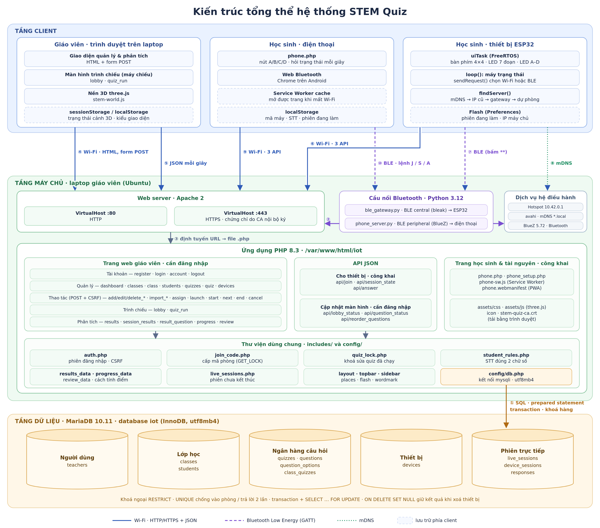

Ảnh vector (phóng to không vỡ, chèn vào Word được): `diagrams/00-kien-truc-tong-the-chi-tiet.svg`.

Đọc từ trên xuống:
- **Tầng client** có 3 loại:
  - Trình duyệt giáo viên: quản lý, trình chiếu, nền 3D.
  - Điện thoại học sinh: `phone.php`, Web Bluetooth, bộ nhớ đệm offline.
  - Thiết bị ESP32: luồng giao diện FreeRTOS, máy trạng thái, tìm máy chủ, bộ nhớ flash.
- **Tầng máy chủ:**
  - Apache nhận mọi yêu cầu HTTP/HTTPS.
  - Cầu nối Bluetooth nhận yêu cầu BLE rồi gọi lại Apache qua localhost.
  - Ứng dụng PHP chia 3 nhóm: trang giáo viên, API JSON, trang học sinh và tài nguyên. Cả 3 nhóm cùng dùng thư viện `includes/`.
  - Chỉ `config/db.php` nói chuyện với database.
- **Tầng dữ liệu:** MariaDB có 11 bảng, chia 5 nhóm.

### 0.1. Bảng luồng dữ liệu

| Số | Từ → đến | Giao thức | Nội dung |
|---|---|---|---|
| ① | Ứng dụng PHP → MariaDB | mysqli, prepared statement | Đọc/ghi mọi dữ liệu. Thao tác nhạy cảm (vào phòng, trả lời, bắt đầu/huỷ phiên) chạy trong transaction có `SELECT … FOR UPDATE`; cấp mã phòng dùng `GET_LOCK` |
| ② | Cầu nối Bluetooth → Apache | HTTP `127.0.0.1` | Chuyển yêu cầu nhận qua Bluetooth thành đúng lời gọi API như thiết bị Wi-Fi; danh sách trắng chỉ gồm `join`, `session_state`, `answer` |
| ③ | Client → Apache | HTTP :80 / HTTPS :443 | Trang HTML cho giáo viên, JSON cho thiết bị và màn hình trình chiếu, tài nguyên tĩnh |
| ④ | Trình duyệt giáo viên → trang web | HTTP, form POST + CSRF | Quản lý lớp, học sinh, quiz, thiết bị; nhập CSV/Excel; Launch/Start/Next/End |
| ⑤ | Lobby / quiz_run → API trực tiếp | HTTP GET JSON, khoảng 1 giây | Ai đã vào phòng, bao nhiêu em đã trả lời câu hiện tại |
| ⑥ | ESP32 → API thiết bị | Wi-Fi, HTTP + JSON | Vào phòng, hỏi trạng thái mỗi giây, gửi đáp án |
| ⑦ | ESP32 ↔ cầu nối | BLE GATT (ESP là peripheral) | Cùng nội dung ⑥, đóng gói `"<seq>\n<path>\n<body>"` |
| ⑧ | ESP32 → avahi | mDNS | Tìm IP máy chủ theo tên `*.local`, không cần ghi cứng IP |
| ⑨ | Điện thoại → API thiết bị | Wi-Fi, HTTP(S) + JSON | Giống ⑥, từ trang `phone.php` |
| ⑩ | Điện thoại ↔ cầu nối | BLE GATT (laptop là peripheral) | Lệnh ngắn `J,03,09,49` / `S,03,19` / `A,03,19,123,B`, ghi rồi đọc lại JSON |

### 0.2. Dữ liệu được lưu ở đâu

| Nơi lưu | Dữ liệu | Thời hạn |
|---|---|---|
| MariaDB | Toàn bộ dữ liệu nghiệp vụ (11 bảng) | Lâu dài, là nguồn sự thật duy nhất |
| Phiên PHP (máy chủ) | `teacher_id` đăng nhập, CSRF token | Đến khi đăng xuất / hết phiên |
| Flash ESP32 (`Preferences`) | `session` đang làm, IP máy chủ tìm được | Qua mất điện, khởi động lại |
| `localStorage` điện thoại | Mã máy, STT, phiên đang làm | Qua tải lại trang |
| Service Worker cache | Bản sao `phone.php`, manifest, icon | Để mở được khi mất Wi-Fi |
| `sessionStorage` trình duyệt giáo viên | Trạng thái và ảnh chụp cảnh 3D | Trong một tab, để chuyển trang liền mạch |
| `localStorage` trình duyệt giáo viên | Kiểu giao diện, tạm dừng chuyển động | Lâu dài trên máy đó |

---

## 1. Sơ đồ kiến trúc tổng thể

Hệ thống gồm 3 nhóm người dùng và thiết bị (giáo viên, học sinh dùng ESP32, học sinh dùng điện thoại) cùng nói chuyện với một máy chủ duy nhất là laptop giáo viên.

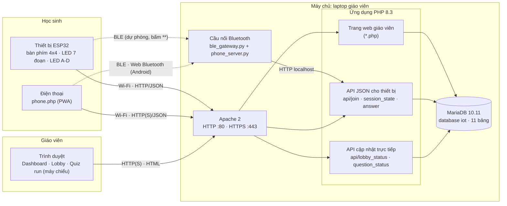

Điểm chính:
- **Một nguồn sự thật duy nhất là database**. Thiết bị đi đường nào (Wi-Fi hay Bluetooth) cuối cùng cũng gọi cùng 3 API, nên logic nghiệp vụ chỉ nằm ở một chỗ.
- Cầu nối Bluetooth chỉ là **bộ chuyển đổi giao thức** (BLE ↔ HTTP), không chứa logic nghiệp vụ.

---

## 2. Sơ đồ triển khai mạng

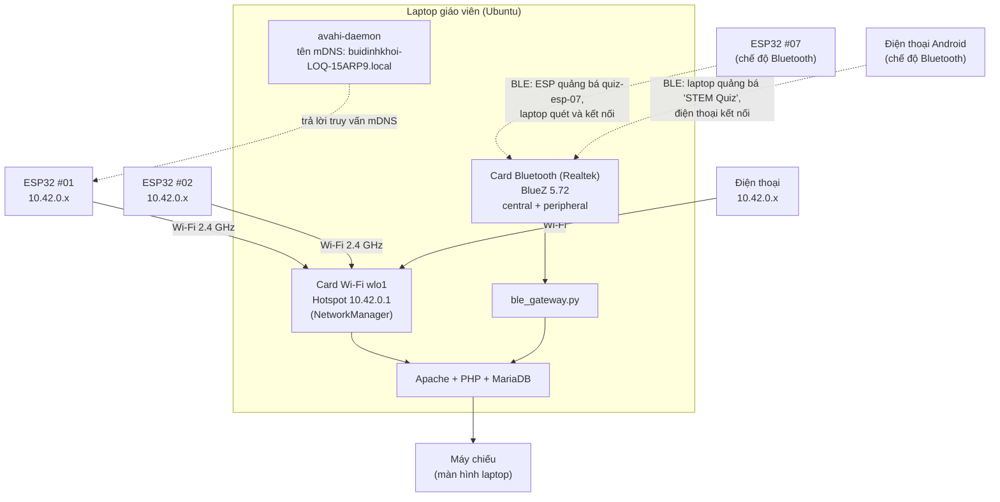

- Không cần Internet trong giờ học: laptop **tự phát Wi-Fi**, tự làm máy chủ web và trạm Bluetooth.
- Hai chiều Bluetooth **ngược vai nhau**:
  - Với ESP32, laptop là **central** (đi tìm và kết nối).
  - Với điện thoại, laptop là **peripheral** (phát quảng bá cho trình duyệt tìm), vì trình duyệt chỉ làm được central.

---

## 3. Sơ đồ phân tầng phần mềm phía máy chủ

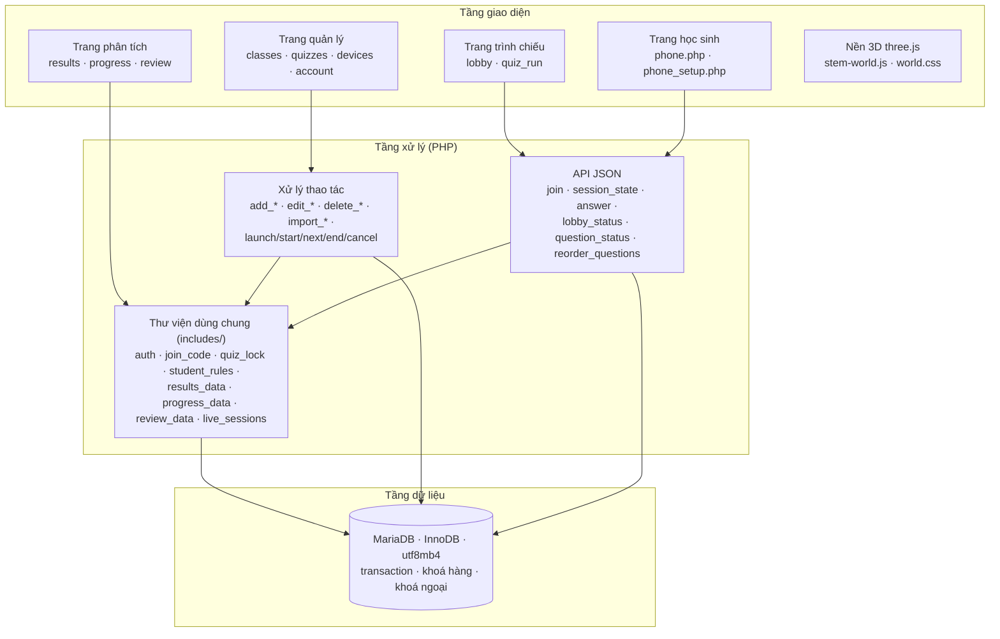

---

## 4. Sơ đồ cơ sở dữ liệu (ERD)

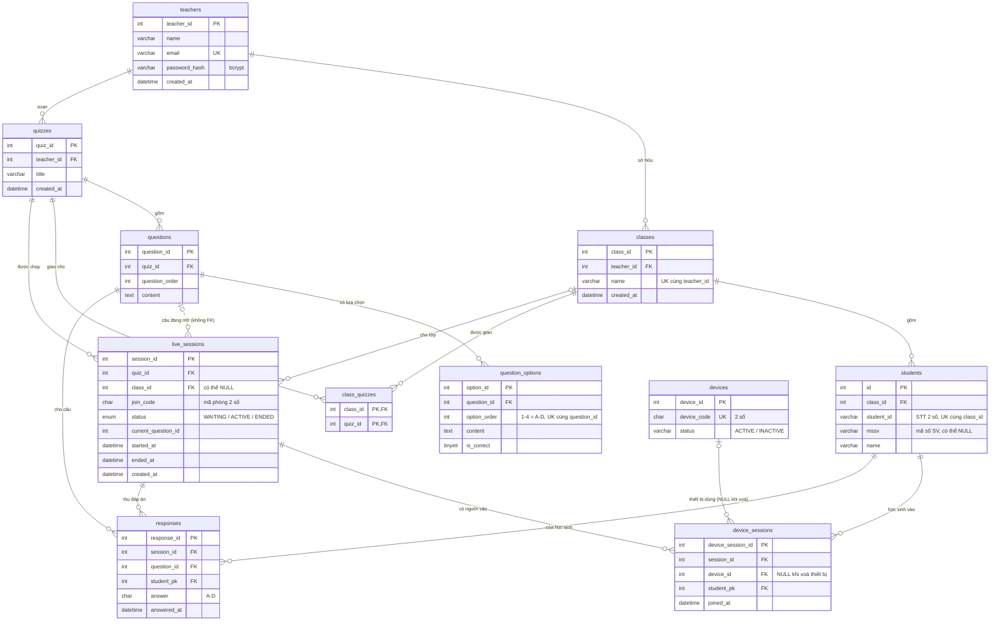

### 4.1. Nhóm bảng
| Nhóm | Bảng | Ý nghĩa |
|---|---|---|
| Người dùng | `teachers` | Tài khoản giáo viên; mọi dữ liệu khác tách theo giáo viên |
| Lớp học | `classes`, `students` | Lớp và danh sách học sinh (STT · MSSV · Họ tên) |
| Ngân hàng câu hỏi | `quizzes`, `questions`, `question_options`, `class_quizzes` | Bộ câu hỏi, câu hỏi, lựa chọn A–D, quiz nào giao cho lớp nào |
| Thiết bị | `devices` | Mã 2 số của ESP32 hoặc điện thoại, dùng chung cho mọi giáo viên |
| Phiên trực tiếp | `live_sessions`, `device_sessions`, `responses` | Mỗi lần chạy quiz; ai vào bằng thiết bị nào; ai trả lời gì |

### 4.2. Ràng buộc quan trọng
| Ràng buộc | Bảng | Tác dụng |
|---|---|---|
| `UNIQUE (session_id, question_id, student_pk)` | `responses` | Mỗi học sinh chỉ trả lời **1 lần mỗi câu**, kể cả khi 2 yêu cầu đến cùng lúc |
| `UNIQUE (session_id, device_id)` | `device_sessions` | Một thiết bị chỉ vào một phòng một lần |
| `UNIQUE (session_id, student_pk)` | `device_sessions` | Một học sinh chỉ vào phòng bằng một thiết bị |
| `UNIQUE (class_id, student_id)` | `students` | STT không trùng trong lớp |
| `UNIQUE (question_id, option_order)` | `question_options` | Mỗi câu chỉ có một A, một B… |
| `UNIQUE device_code` | `devices` | Mã thiết bị không trùng |
| `INDEX (join_code, status)` | `live_sessions` | Tìm nhanh phòng đang mở theo mã phòng khi thiết bị vào |
| Khoá ngoại `RESTRICT` | mọi bảng | Không xoá được dữ liệu đang được dùng (ví dụ quiz đã có kết quả) |
| `ON DELETE SET NULL` | `device_sessions.device_id` | Xoá mã thiết bị **vẫn giữ kết quả** cũ của học sinh |

### 4.3. Cách tính điểm từ dữ liệu
- **Câu đã được hỏi** trong một phiên: các câu có `question_order` ≤ thứ tự của câu cuối cùng được mở.
- **Điểm học sinh** = số `responses` đúng (đáp án trùng `question_options.is_correct = 1`) / số câu đã được hỏi.
- Chỉ tính phiên `ENDED` có ít nhất một học sinh tham gia. Trang Kết quả, Tiến bộ và Ôn tập dùng chung cách tính này.

---

## 5. Sơ đồ tuần tự một buổi quiz (qua Wi-Fi)

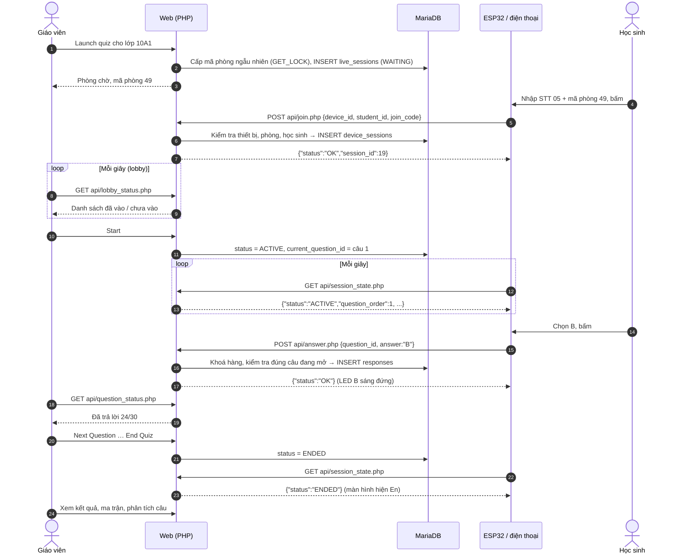

---

## 6. Sơ đồ tuần tự đường Bluetooth

### 6.1. ESP32 qua Bluetooth (laptop là central)
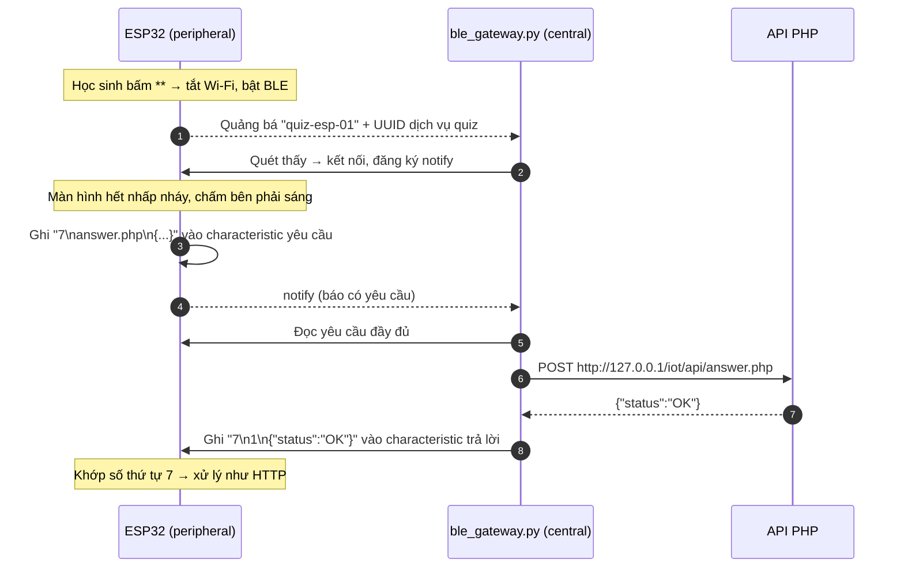

### 6.2. Điện thoại Android qua Bluetooth (laptop là peripheral)
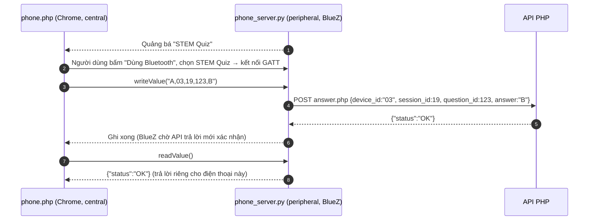

Lệnh ngắn của điện thoại (vừa một gói BLE 20 byte):

| Lệnh | API tương ứng |
|---|---|
| `J,<máy>,<STT>,<mã phòng>` | `join.php` |
| `S,<máy>,<session_id>` | `session_state.php` |
| `A,<máy>,<session_id>,<question_id>,<A-D>` | `answer.php` |

---

## 7. Sơ đồ trạng thái phiên quiz (`live_sessions.status`)

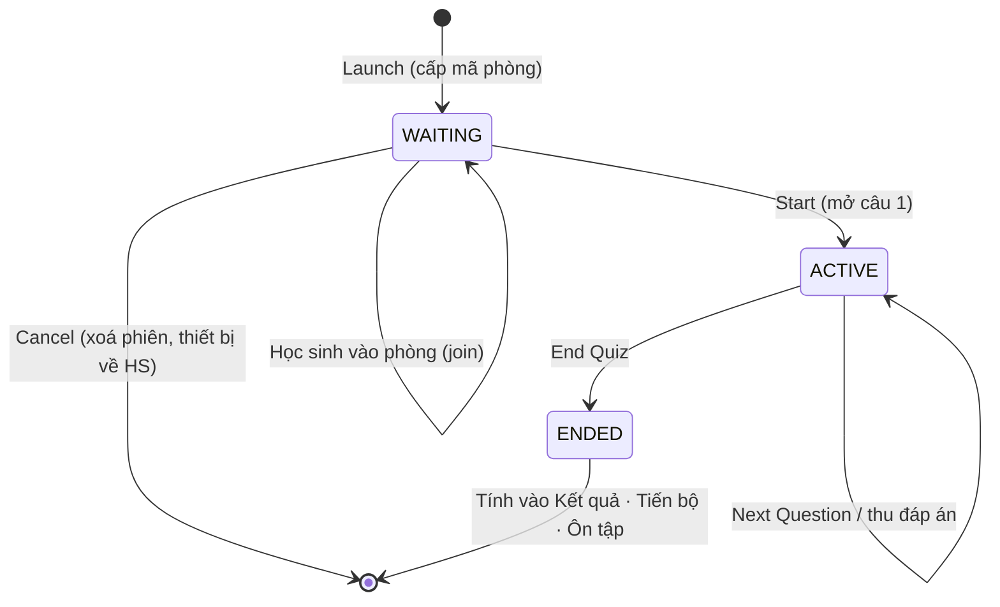

---

## 8. Sơ đồ trạng thái thiết bị ESP32

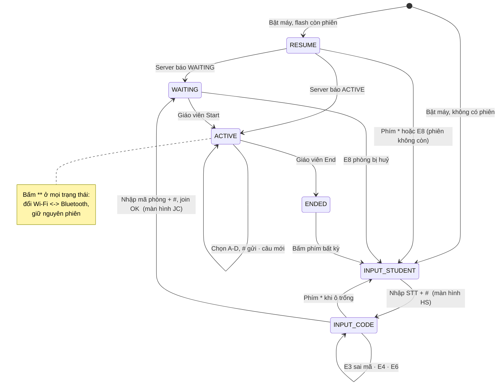

Kiến trúc bên trong firmware:

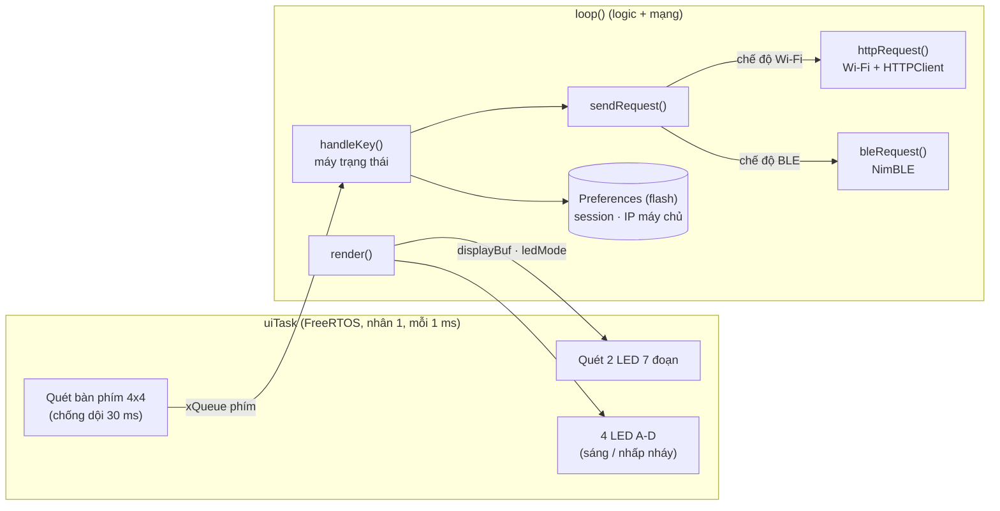

---

## 9. Thuật toán tự tìm máy chủ của ESP32

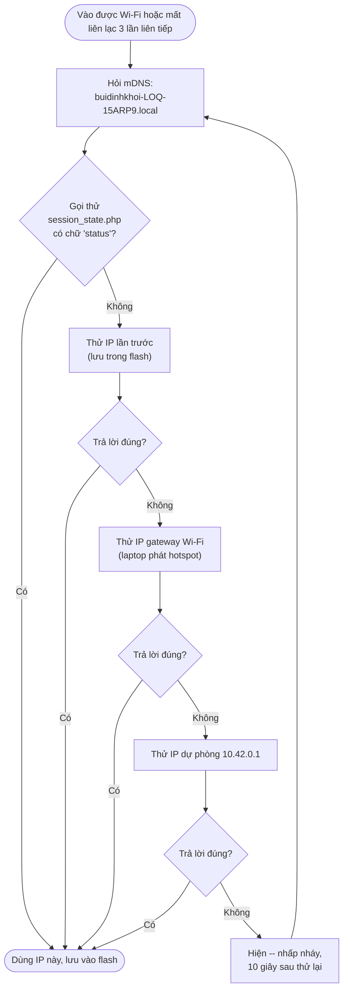
